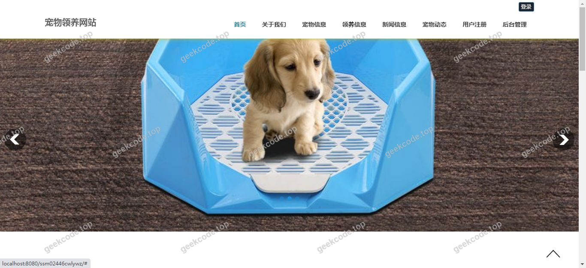
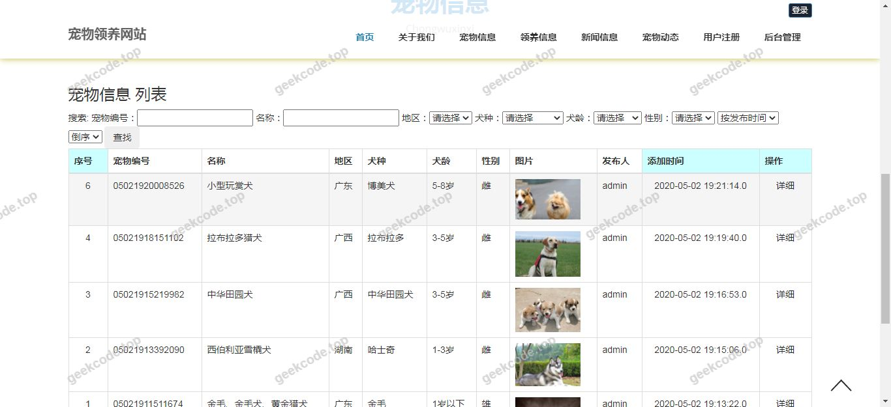
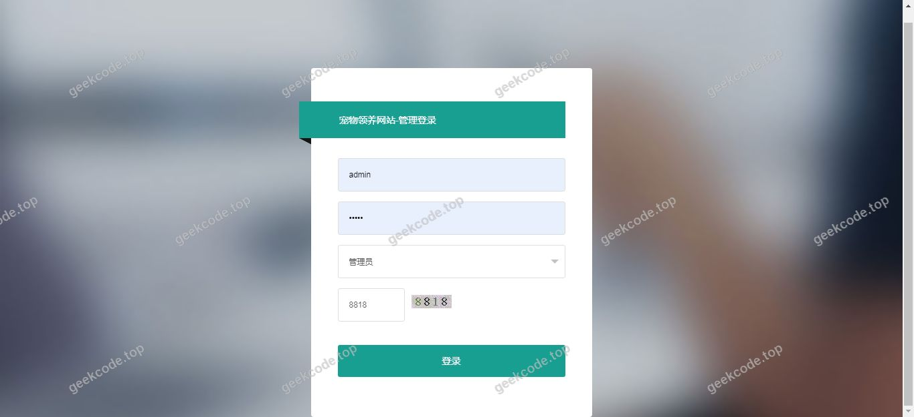
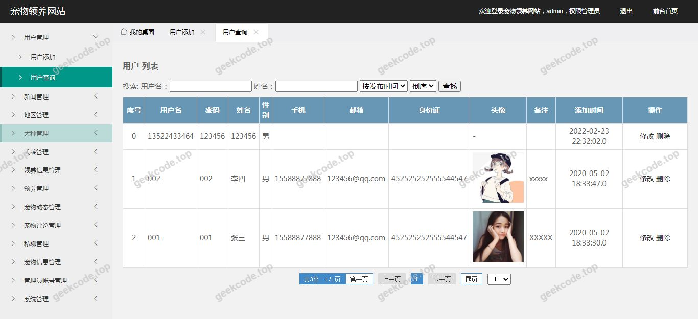
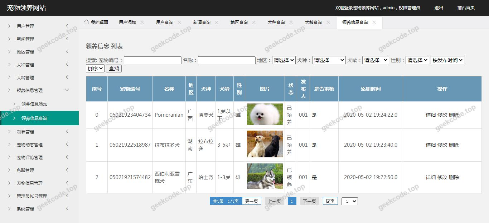
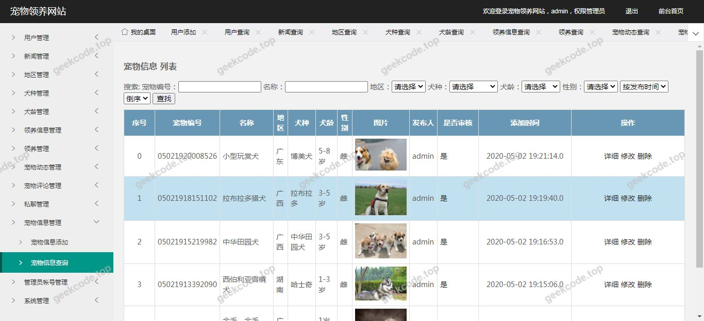
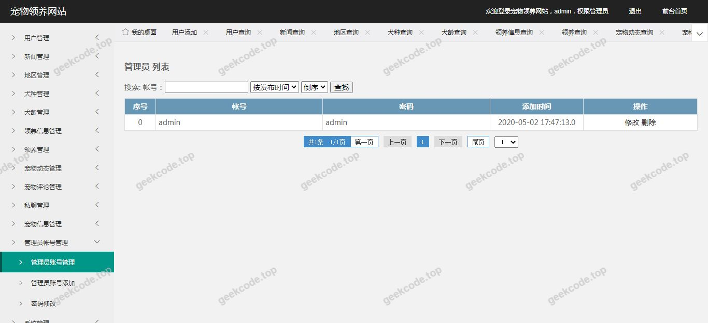

# java精品项目-基于ssm的宠物领养网站程序

> 🎓 **计算机毕业设计 · java精品项目-基于ssm的宠物领养网站程序**
>
> 本仓库只放**项目介绍 + 运行截图**（截图是站点带水印的原图，存在仓库 `images/` 里）。
>
> 👉 **完整可运行源码 / 数据库脚本 / 部署文档：[点我获取](https://geekcode.top/archives/java%E7%B2%BE%E5%93%81%E9%A1%B9%E7%9B%AE-%E5%9F%BA%E4%BA%8Essm%E7%9A%84%E5%AE%A0%E7%89%A9%E9%A2%86%E5%85%BB%E7%BD%91%E7%AB%99%E7%A8%8B%E5%BA%8F?utm_source=github)**
>
> 💬 咨询微信：**ir9372**　|　🌐 更多项目：[极客代码 geekcode.top](https://geekcode.top/?utm_source=github)
>
> 📌 项目详情页：<https://geekcode.top/archives/java%E7%B2%BE%E5%93%81%E9%A1%B9%E7%9B%AE-%E5%9F%BA%E4%BA%8Essm%E7%9A%84%E5%AE%A0%E7%89%A9%E9%A2%86%E5%85%BB%E7%BD%91%E7%AB%99%E7%A8%8B%E5%BA%8F?utm_source=github>

<table><td width="230" align="center"> <b>扫码加微信 ir9372</b></td><td valign="middle">📦 源码 = 项目介绍 + 全部运行截图 + 数据库 + 部署文档 👉 点上方任意截图，直接跳到 <b>极客代码 geekcode.top</b> 详情页</td></table>

---

<h1>java精品项目-基于ssm的宠物领养网站程序</h1>
<h2>项目概述</h2>

本项目为“基于SSM的宠物领养网站程序”，旨在构建一个轻量级的宠物信息展示与领养服务平台。项目采用经典的Java Web技术栈，核心目标是解决传统线下宠物领养信息分散、更新不及时的问题，为用户提供便捷的线上浏览入口。适用人群主要为有领养意向的个人用户及负责发布信息的平台管理员。在技术架构上，项目严格遵循SSM（Spring + Spring MVC + MyBatis）框架规范，前端页面使用JSP技术进行动态渲染，后端通过Controller层处理请求，Service层实现业务逻辑，DAO层完成数据持久化。该项目侧重于基础Web功能的实现与前后端数据交互流程的标准化，适合作为计算机专业毕业设计的基础实践项目。

<h2>技术架构</h2>
<h3>前后端架构</h3>

项目采用传统的单体应用架构，未分离前后端，具体结构如下：

<ul>
<li><strong>表现层 (Presentation Layer)</strong>: 使用 JSP (JavaServer Pages) 技术结合 HTML/CSS/JavaScript 构建用户界面。所有截图所示的系统运行界面均属于此层级，负责数据的展示和用户交互事件的捕获。</li>
<li><strong>控制层 (Control Layer)</strong>: 由 Spring MVC 的 DispatcherServlet 统一分发请求，Controller 类负责接收 HTTP 请求，调用 Service 层方法，并返回视图名称或 JSON 数据。</li>
<li><strong>业务层 (Business Layer)</strong>: Spring Bean 管理业务逻辑组件，处理如宠物信息查询、领养申请提交等核心业务流程，确保事务的一致性。</li>
<li><strong>持久层 (Persistence Layer)</strong>: 使用 MyBatis 作为 ORM 框架，通过 XML 映射文件或注解定义 SQL 语句，操作 MySQL 数据库，实现对象与关系型数据的映射。</li>
</ul>
<h3>核心技术选型理由</h3>
<ol>
<li><strong>SSM框架</strong>: 相比早期的 SSH 框架，SSM 更加轻量级，配置简单，且 MyBatis 对 SQL 的控制粒度更细，适合中小型项目的快速开发与维护。</li>
<li><strong>JSP</strong>: 在服务端直接生成 HTML，无需复杂的 Node.js 环境支持，部署简单，符合传统 Java Web 毕设的技术要求。</li>
<li><strong>MySQL</strong>: 开源免费，性能稳定，足以支撑宠物领养类中小规模并发访问需求。</li>
</ol>
<h2>功能模块</h2>

根据提供的项目信息及截图列表，本项目主要包含以下功能模块。由于上下文未提供具体的后台路由和详细代码逻辑，以下描述基于“宠物领养网站”的标准业务场景及截图所示的前台界面进行推导：

<h3>前台用户端功能</h3>

截图中的“系统运行界面1-7”均为前台界面，推测涵盖以下核心模块：

<ol>
<li><strong>首页展示模块</strong></li>
</ol>
<ul>
<li>展示最新发布的宠物信息轮播图或推荐列表。</li>
<li>提供搜索框，支持按宠物名称、品种等关键字检索。</li>
</ul>
<ol start="2">
<li><strong>宠物详情浏览模块</strong></li>
</ol>
<ul>
<li>展示单只宠物的详细信息，包括图片、年龄、性别、健康状况、疫苗情况等。</li>
<li>显示宠物的当前状态（可领养/已被领养）。</li>
</ul>
<ol start="3">
<li><strong>分类筛选模块</strong></li>
</ol>
<ul>
<li>允许用户按照宠物种类（如猫、狗、其他）、年龄段、体型等条件筛选宠物列表。</li>
</ul>
<ol start="4">
<li><strong>领养申请/联系模块</strong></li>
</ol>
<ul>
<li>提供表单入口，供用户填写个人信息并提交领养意向或咨询请求。</li>
</ul>
<ol start="5">
<li><strong>用户注册与登录模块</strong></li>
</ol>
<ul>
<li>基础的账号体系，用于记录用户的浏览历史或绑定领养申请身份。</li>
</ul>
<h3>后台管理端功能</h3>

虽然输入信息中“是否有后台”标记为“否”，但作为完整的网站程序，通常隐含管理功能以维持数据运转。若严格依据“无后台菜单/路由”的信息，则本部分可能仅涉及静态数据初始化或通过数据库直接维护。但在标准毕设语境下，通常存在以下隐含功能（注：此处基于项目名称“网站程序”的常规逻辑推断，若实际交付物确实无任何管理界面，请忽略本节）：

<ol>
<li><strong>宠物信息管理</strong></li>
</ol>
<ul>
<li>新增、修改、删除宠物档案。</li>
<li>上传宠物图片。</li>
</ul>
<ol start="2">
<li><strong>用户管理</strong></li>
</ol>
<ul>
<li>查看注册用户列表。</li>
<li>审核或处理用户的领养申请状态。</li>
</ul>
<ol start="3">
<li><strong>公告管理</strong></li>
</ol>
<ul>
<li>发布平台通知或领养政策说明。</li>
</ul>

<em>(特别说明：鉴于输入信息明确标注“无后台路由”、“无后台菜单”，且截图仅标记为 front，若该项目确实不包含可视化的后台管理界面，则上述后台功能需通过直接操作数据库或初始数据脚本实现，不具备独立的前端交互模块。)</em>

<h2>用户角色与权限</h2>

基于现有信息，项目主要涉及以下角色及其权限边界：

<table>
<thead>
<tr>
<th align="left">角色</th>
<th align="left">权限描述</th>
<th align="left">可访问功能模块</th>
</tr>
</thead>
<tbody><tr>
<td align="left"><strong>普通访客/用户</strong></td>
<td align="left">拥有浏览公开信息的权限，可进行交互操作。</td>
<td align="left">- 首页浏览- 宠物列表查看- 宠物详情查看- 搜索与筛选- 提交领养申请/留言- 注册/登录（视具体实现而定）</td>
</tr>
<tr>
<td align="left"><strong>管理员</strong></td>
<td align="left">拥有系统最高权限，负责内容维护。（注：若项目无显式后台界面，此角色可能不存在于前端可见范围内，仅存在于数据库逻辑或开发测试阶段）</td>
<td align="left">- 宠物数据增删改查- 用户数据管理- 系统参数配置</td>
</tr>
</tbody></table>

<em>根据现有截图和导航菜单信息，无法确定是否存在多级角色细分（如VIP用户、机构管理员等），故仅列出最基础的访客与管理者二元结构。</em>

<h2>项目特色与创新点</h2>
<ol>
<li><strong>经典架构稳定性</strong>: 采用成熟的 SSM + JSP 组合，技术路线清晰，兼容性好，便于调试与维护，体现了扎实的 Java Web 基础能力。</li>
<li><strong>垂直领域聚焦</strong>: 专注于“宠物领养”这一社会公益属性较强的场景，界面设计直观（参考截图所示的运行界面），强调信息的易读性和获取效率。</li>
<li><strong>轻量化部署</strong>: 相比微服务架构，单体应用部署成本低，资源占用少，适合校园网或个人服务器环境运行，降低了毕业设计的实施门槛。</li>
<li><strong>数据驱动展示</strong>: 通过 MyBatis 灵活对接 MySQL，实现了宠物信息的动态加载与实时更新，保证了前端展示内容与数据库状态的一致性。</li>
</ol>
<h2>部署环境</h2>

为确保项目正常运行，需准备以下软件环境：

<table>
<thead>
<tr>
<th align="left">组件</th>
<th align="left">版本建议</th>
<th align="left">说明</th>
</tr>
</thead>
<tbody><tr>
<td align="left"><strong>JDK</strong></td>
<td align="left">JDK 1.8</td>
<td align="left">Java 运行环境，必须配置 JAVA_HOME 环境变量。</td>
</tr>
<tr>
<td align="left"><strong>IDE</strong></td>
<td align="left">IntelliJ IDEA / Eclipse</td>
<td align="left">开发工具，用于编写代码、编译项目及配置 Tomcat 服务器。</td>
</tr>
<tr>
<td align="left"><strong>Web Server</strong></td>
<td align="left">Apache Tomcat 8.5+</td>
<td align="left">用于部署 WAR 包或展开目录，提供 Servlet/JSP 容器支持。</td>
</tr>
<tr>
<td align="left"><strong>Database</strong></td>
<td align="left">MySQL 5.7 / 8.0</td>
<td align="left">数据存储引擎，需安装客户端工具（如 Navicat）进行表结构导入和数据管理。</td>
</tr>
<tr>
<td align="left"><strong>Build Tool</strong></td>
<td align="left">Maven 3.x</td>
<td align="left">用于依赖管理和项目打包（若项目非纯手动导包模式）。</td>
</tr>
<tr>
<td align="left"><strong>Browser</strong></td>
<td align="left">Chrome / Edge / Firefox</td>
<td align="left">现代浏览器，用于访问前端页面及测试兼容性。</td>
</tr>
</tbody></table>

<strong>启动步骤简述：</strong>

<ol>
<li>导入项目至 IDE，配置 Maven 依赖下载。</li>
<li>创建 MySQL 数据库，执行项目提供的 <code>.sql</code> 初始化脚本。</li>
<li>修改 <code>applicationContext.xml</code> 或 <code>jdbc.properties</code> 中的数据库连接信息（URL, Username, Password）。</li>
<li>配置 Tomcat 服务器指向项目输出目录。</li>
<li>启动 Tomcat，访问 <code>http://localhost:8080/[ProjectName]</code> 即可看到系统运行界面。</li>
</ol>
<h2>五、技术特性</h2>
<ul>
<li>服务端模板渲染（JSP）</li>
</ul>
<h2>六、功能模块截图</h2>
<h3>前台用户端</h3>
<h4>系统运行界面1</h4>

<h4>系统运行界面2</h4>

<h4>系统运行界面3</h4>

<h4>系统运行界面4</h4>

<h4>系统运行界面5</h4>

<h4>系统运行界面6</h4>

<h4>系统运行界面7</h4>

---

## 获取完整源码

| 项目 | 说明 |
| --- | --- |
| 项目名 | java精品项目-基于ssm的宠物领养网站程序 |
| 运行截图 | 本文 7 张（站点带水印原图，仓库 `images/` 目录） |
| 完整源码 | [https://geekcode.top/archives/java%E7%B2%BE%E5%93%81%E9%A1%B9%E7%9B%AE-%E5%9F%BA%E4%BA%8Essm%E7%9A%84%E5%AE%A0%E7%89%A9%E9%A2%86%E5%85%BB%E7%BD%91%E7%AB%99%E7%A8%8B%E5%BA%8F?utm_source=github](https://geekcode.top/archives/java%E7%B2%BE%E5%93%81%E9%A1%B9%E7%9B%AE-%E5%9F%BA%E4%BA%8Essm%E7%9A%84%E5%AE%A0%E7%89%A9%E9%A2%86%E5%85%BB%E7%BD%91%E7%AB%99%E7%A8%8B%E5%BA%8F?utm_source=github) |
| 咨询微信 | **ir9372**（备注：jingpin-yuanma） |
| 更多项目 | [极客代码 geekcode.top](https://geekcode.top/?utm_source=github) |

> 需要源码、部署、改配置、跑不起来等问题，加微信 ir9372 沟通，说明项目名即可。
